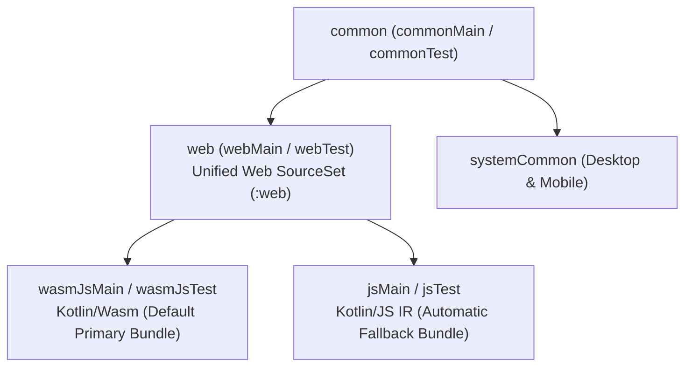

# GenericUI — Web Submodule (`:web`)

> **Root Repository**: [**GenericUI (`../README.md`)**](../README.md) | **Root Documentation**: [SourceSet Hierarchy](../docs/sourcesets.md) · [Backends Guide](../docs/backends.md) · [Extensions Guide](../docs/extensions.md) · [Gradle Plugin](../docs/gradle-plugin.md) · [UI Testing](../docs/testing.md)

The **Web Submodule (`:web`)** of **GenericUI** (`com.nexustools.genericui.web.*`) is the browser platform backend for the GenericUI Kotlin Multiplatform framework. When `web()` is enabled in `genericui { backends { ... } }`, the build compiles **both** **Kotlin/Wasm (`wasmJs`)** and **Kotlin/JS IR (`js(IR)`)** bundles, using `genericui-loader.js` to load the **Wasm bundle by default** and **automatically fall back to the JS IR bundle** if the user's browser does not support WebAssembly / WasmGC.

---

## Categorized Overview of `:web`

| Functional Area | Key Classes / Resources | Responsibility | Detailed Guide |
| :--- | :--- | :--- | :--- |
| **Dual Wasm (`wasmJs`) + JS IR (`js`) Compilation & Loader** | `WebWasmJsLoader`, `genericui-loader.js`, `index.template.html`, `WebHtmlTemplateEngine`, `WebSha1Hasher` | Compiles both `wasmJs` and `js(IR)` targets; emits `<script type="loader-wasm" src="{{WASM_URL}}?{{WASM_HASH}}">`, `<script type="loader-js" src="{{JS_URL}}?{{JS_HASH}}">`, and `<script id="genericui-loader-script" src="{{LOADER_JS_URL}}?{{LOADER_JS_HASH}}" defer>` (with **no** `{{APP_BUNDLE_SCRIPT}}` and **no** hash on `{{BOOTSTRAP_JS_URL}}`); probes WasmGC support and loads Wasm first with automatic JS IR fallback. | [**`docs/wasm-js-loader-and-splash.md`**](./docs/wasm-js-loader-and-splash.md) |
| **Bootstrap 5 Splash Screen, Progress Bar, Error Stacktrace, & `.svg` Web Icon** | `WebSplashConfig`, `WebHtmlTemplateEngine`, `webIcon("icon.svg")` | Renders `#genericui-splash` with the project's `64x64` icon (`#genericui-splash-icon`, **`.svg` preferred** for both splash screen and `<link id="genericui-favicon">` favicon), streaming download progress bar (`#genericui-splash-progress-bar`), smooth fade-out on startup, and runtime error stacktrace alert (`#genericui-splash-error` & `#genericui-splash-error-stack`). | [**`docs/wasm-js-loader-and-splash.md`**](./docs/wasm-js-loader-and-splash.md) |
| **Progressive Web App (PWA) Manifest (`manifest.webmanifest`), Android/Chrome Installable WebApp (`allowInstallAsWebApp`), & `themeColor`** | `WebAppManifestConfig`, `WebAppManifestIcon`, `WebAppManifestShortcut`, `GenericUiWebManifestConfig`, `GenericUiWebDistributionTask` | Generates W3C / MDN `manifest.webmanifest` (`https://developer.mozilla.org/en-US/docs/Web/Progressive_web_apps/Manifest`), propagates `application { themeColor = "#..." }` to `<meta name="theme-color">` and `theme_color`, and injects installable WebApp `<head>` tags (`allowInstallAsWebApp = true`) so Chrome on Android, iOS Safari, and Desktop browsers can install the app as a standalone WebApp. | [**`docs/wasm-js-loader-and-splash.md`**](./docs/wasm-js-loader-and-splash.md) |
| **Native HTML5 DOM Widgets & Dual-Mode Bootstrap 5 Styling** | `WebNativeFactory`, `WebBaseNativeImpl`, `WebBaseContainerNativeImpl`, `WebDomElement`, `WebBrowserDomBridge`, `WebBootstrapCdnConfig` | Maps GenericUI widgets directly to semantic HTML5 DOM elements (`<button>`, `<input>`, `<select>`, `<nav>`, `<dialog>`, `<table>`), synchronizes Bootstrap 5 CSS classes (`classList`) with compiled SASS/CSS `ComputedStyle` rules, and mounts live DOM bridges in both `wasmJsMain` and `jsMain`. | [**`docs/web-backend.md`**](./docs/web-backend.md) |
| **Invisible `<input type="file">` File & Folder Picker** | `WebFileBrowserDialogImpl` | Implements `FileBrowserDialogNativeImpl` using a completely invisible, un-interactable `<input type="file" tabindex="-1" aria-hidden="true">` with `webkitdirectory` / `directory` (for `SELECT_FOLDER`), `multiple` (for `OPEN_MULTIPLE_FILES`), and `accept` MIME/extension filtering. | [**`docs/web-backend.md`**](./docs/web-backend.md) |
| **True DOM-Windowed Lazy Views** | `WebLazyListImpl`, `WebLazyGridImpl`, `WebTreeViewImpl` | Dynamically mounts DOM elements **only** for items inside the visible scroll window `[firstVisibleIndex .. lastVisibleIndex]` using top/bottom scroll spacers (`lazy-list-spacer-start` / `lazy-list-spacer-end`), unmounting offscreen DOM nodes immediately. | [**`docs/web-backend.md`**](./docs/web-backend.md) |
| **HTML5 Canvas2D, WebGL2, & WebGPU Surfaces** | `:extensions:canvas2d:web`, `:extensions:canvas3d:web`, `:extensions:gpu:web`, `WebBrowserImageCodecImpl` | Synchronizes `Canvas2D` (HTML5 2D Context), `GLCanvas` (WebGL2 `#version 300 es`), and `VKCanvas` (WebGPU / SPIR-V translation) to `window.requestAnimationFrame` with high-resolution `deltaMs` timing, plus `createImageBitmap` / `<canvas>` image decoding. | [**`docs/web-backend.md`**](./docs/web-backend.md) |

---

## Hierarchical SourceSet Integration (`common` $\rightarrow$ `web`)

In GenericUI's sourceSet hierarchy, `:web` branches directly from **`common`** (`commonMain` / `commonTest` $\rightarrow$ `webMain` / `webTest`), remaining cleanly isolated from `systemCommon` (which targets native OS & JVM filesystems/sockets). Internally, the `web` sourceSet fans out to both **`wasmJsMain`** and **`jsMain`** so your web-specific code compiles seamlessly to both WebAssembly and JavaScript IR:



For the complete sourceSet hierarchy across all 8 backends, see [**Root SourceSet Hierarchy (`../docs/sourcesets.md`)**](../docs/sourcesets.md).

---

## Quick Start: Configuring `:web` & `.svg` Web Icons in `build.gradle.kts`

```kotlin
plugins {
    kotlin("multiplatform")
    id("com.nexustools.genericui")
}

genericui {
    backends {
        // Compiles BOTH wasmJs (default primary bundle) and js(IR) (automatic fallback bundle)
        // and generates index.html with genericui-loader.js and SHA-1 cache-busting hashes:
        web()
    }

    application {
        appName = "HAEditor Web Studio"
        appId = "com.nexustools.haeditor.web"
        appVersion = "2.4.0"

        // Cross-backend theme color applied across Web (<meta name="theme-color">, manifest.webmanifest,
        // --genericui-theme-color), Android (colors.xml theme_color / colorPrimary), iOS/macOS
        // (AccentColor.colorset), Windows (.rc ThemeColor), and Linux (.desktop X-GenericUI-ThemeColor):
        themeColor = "#2A80FF"

        // .svg vector icons (image/svg+xml) are preferred for the Web icon!
        // Used automatically for the <link id="genericui-favicon"> tag in <head>,
        // the 64x64 #genericui-splash-icon  inside the Bootstrap splash screen,
        // and the manifest.webmanifest icons:
        webIcon("src/commonMain/resources/icons/icon.svg")

        // Optional: Generate W3C / MDN manifest.webmanifest and enable standalone WebApp
        // installation on Android via Chrome ("Add to Home screen" / WebAPK):
        webManifest {
            allowInstallAsWebApp = true
            shortName = "HAEditor"
            description = "Hybrid Vector & Raster Studio"
            display = "standalone"
            orientation = "any"
            backgroundColor = "#0B0E14"
            categories("graphics", "productivity")
        }

        // Or configure all platform icons together:
        icons(
            windows = "src/commonMain/resources/icons/icon.ico",
            mac = "src/commonMain/resources/icons/icon.icns",
            linux = "src/commonMain/resources/icons/icon.png",
            web = "src/commonMain/resources/icons/icon.svg",
            common = "src/commonMain/resources/icons/icon.png"
        )
    }

    extensions {
        canvas2d() // HTML5 2D Context Canvas2D
        canvas3d() // WebGL2 GLCanvas & WebGPU VKCanvas
        webView()  // Uses native HTML5 <iframe> on :web (never NJS)
    }
}
```

### Web Gradle Tasks

| Task Name | Description |
| :--- | :--- |
| `./gradlew webDevelopment` | Compiles debug `wasmJs` and `js(IR)` bundles, computes SHA-1 hashes (`WebSha1Hasher`), renders `index.html` from `index.template.html` with `genericui-loader.js` and the `.svg` splash/favicon icon, and starts the live reload development server. |
| `./gradlew webProduction` | Compiles production-minified `wasmJs` (binaryen optimized) and `js(IR)` (webpack/terser optimized) bundles, injects SHA-1 cache-busting hashes into `index.html`, and outputs a static deployable web distribution directory. |
| `./gradlew webTest` / `./gradlew jsTest` | Runs the `JestElectricRunner` UI test suite against the Web DOM backend (`WebJestElectricRunnerNativeImpl`). |

---

## Web Documentation Guides (`web/docs/*.md`)

1. [**Web Backend Architecture & DOM Widgets (`docs/web-backend.md`)**](./docs/web-backend.md) — Detailed guide & examples for `WebNativeFactory`, semantic HTML5 DOM widgets, Dual-Mode Bootstrap 5 classes + compiled SASS/CSS, `WebFileBrowserDialogImpl` invisible `<input type="file" webkitdirectory multiple accept="...">`, `WebLazyListImpl`/`WebLazyGridImpl`/`WebTreeViewImpl` DOM windowing, HTML5 `Canvas2D` / WebGL2 / WebGPU with `requestAnimationFrame` `deltaMs`, and `common` $\rightarrow$ `web`/`webMain`/`webTest` sourceSets.
2. [**Dual Wasm/JS Loader, SHA-1 Hashing, & Bootstrap Splash Screen (`docs/wasm-js-loader-and-splash.md`)**](./docs/wasm-js-loader-and-splash.md) — Detailed guide & examples for dual Kotlin/Wasm (`wasmJs`) + Kotlin/JS IR (`js`) compilation, `genericui-loader.js` (`WebWasmJsLoader`), `index.template.html`, `WebHtmlTemplateEngine`, `WebSha1Hasher`, `WebSplashConfig`, `webIcon("icon.svg")` (`.svg` preferred for favicon and splash icon), download progress bar updates, and runtime error stacktrace display.

---

## Cross-References to Sibling Submodules & Root Docs

- **Root GenericUI Repository**: [`../README.md`](../README.md)
- **Root Architecture & Guides**:
  - [SourceSet Hierarchy (`../docs/sourcesets.md`)](../docs/sourcesets.md)
  - [Platform Backends Overview (`../docs/backends.md`)](../docs/backends.md)
  - [Extensions Architecture (`../docs/extensions.md`)](../docs/extensions.md)
  - [Gradle Plugin Reference (`../docs/gradle-plugin.md`)](../docs/gradle-plugin.md)
  - [UI Testing Guide (`../docs/testing.md`)](../docs/testing.md)
- **Sibling Submodules**:
  - **Desktop Backends (`:desktop`)**: [`../desktop/README.md`](../desktop/README.md)
  - **Mobile Backends (`:mobile`)**: [`../mobile/README.md`](../mobile/README.md)
  - **UI Testing Suite (`:tests` / `JestElectricRunner`)**: [`../tests/README.md`](../tests/README.md) ([`JestElectricRunner` Guide](../tests/docs/jest-electric-runner.md), [Platform Test Runners](../tests/docs/platform-test-runners.md))
  - **Nexus JavaScript Engine (`:NJS` — Desktop Only, never used on `:web`)**: [`../NJS/README.md`](../lib/NJS/README.md)
