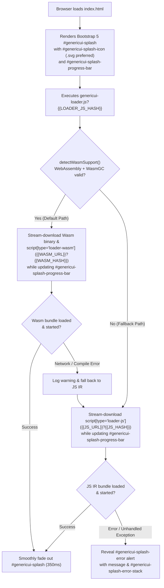

# `:web` — Dual Wasm/JS Loader, SHA-1 Cache Busting, `.svg` Web Icon, & Bootstrap Splash Screen

> **Parent Submodule**: [`:web` (`../README.md`)](../README.md) | **Root Repository**: [**GenericUI (`../../README.md`)**](../../README.md)  
> **Root Docs**: [SourceSet Hierarchy](../../docs/sourcesets.md) · [Backends Guide](../../docs/backends.md) · [Extensions Guide](../../docs/extensions.md) · [Gradle Plugin](../../docs/gradle-plugin.md) · [UI Testing](../../docs/testing.md)  
> **Companion Web Guide**: [**Web Backend & DOM Widgets (`./web-backend.md`)**](./web-backend.md)

When you enable `web()` in `genericui { backends { ... } }`, GenericUI compiles **both** a **Kotlin/Wasm (`wasmJs`)** bundle and a **Kotlin/JS IR (`js(IR)`)** bundle and orchestrates startup via **`genericui-loader.js`** (`WebWasmJsLoader`), **`index.template.html`** (`WebHtmlTemplateEngine`), **`WebSha1Hasher`**, and **`WebSplashConfig`**.

---

## 1. Dual `wasmJs` (Default) + `js(IR)` (Fallback) Architecture

Modern browsers with WebAssembly + WasmGC support execute Kotlin/Wasm (`wasmJs`) with near-native speed and predictable memory layout, while older or restricted browsers require standard JavaScript (`js(IR)`). GenericUI solves this automatically:



---

## 2. `index.template.html` & SHA-1 Cache Busting Rules (`WebHtmlTemplateEngine` & `WebSha1Hasher`)

`src/commonMain/resources/templates/index.template.html` is the authoritative HTML5 template rendered by `WebHtmlTemplateEngine`:

```html
<!DOCTYPE html>
<html lang="{{LANG}}" data-bs-theme="{{THEME_MODE}}">
<head>
    <meta charset="UTF-8">
    <meta name="viewport" content="width=device-width, initial-scale=1.0">
    <title>{{TITLE}}</title>
{{FAVICON_LINK}}
{{WEB_MANIFEST_AND_PWA_LINKS}}
    <link id="genericui-bootstrap-css" rel="stylesheet" href="{{BOOTSTRAP_CSS_URL}}" integrity="{{BOOTSTRAP_CSS_INTEGRITY}}" crossorigin="{{CROSSORIGIN}}">
{{BOOTSTRAP_ICONS_LINK}}
{{EXTRA_STYLESHEETS}}
</head>
<body class="bg-body text-body m-0 p-0">
    <div id="genericui-splash" class="genericui-splash position-fixed top-0 start-0 w-100 h-100 d-flex flex-column align-items-center justify-content-center bg-body text-body p-4" style="z-index: 2000; transition: opacity 0.35s ease, visibility 0.35s ease;">
        <div class="d-flex flex-column align-items-center justify-content-center w-100" style="max-width: 420px;">
{{SPLASH_ICON}}
            <div id="genericui-splash-title" class="fw-semibold fs-5 mb-2 text-center">{{TITLE}}</div>
            <div id="genericui-splash-status" class="genericui-splash-status text-body-secondary small mb-3 text-center">{{SPLASH_STATUS}}</div>
            <div id="genericui-splash-progress" class="progress w-100 mb-2" style="height: 8px;" role="progressbar" aria-label="Application loading progress" aria-valuemin="0" aria-valuemax="100" aria-valuenow="0">
                <div id="genericui-splash-progress-bar" class="{{SPLASH_PROGRESS_BAR_CLASS}}" style="width: 0%" aria-valuenow="0"></div>
            </div>
            <div id="genericui-splash-error" class="genericui-splash-error alert alert-danger d-none text-start w-100 mt-3 mb-0 shadow-sm" role="alert">
                <div class="d-flex align-items-center mb-2">
                    <i class="bi bi-exclamation-triangle-fill me-2" aria-hidden="true"></i>
                    <strong id="genericui-splash-error-title">Application Error</strong>
                </div>
                <div id="genericui-splash-error-message" class="genericui-splash-error-message small fw-semibold mb-2"></div>
                <pre id="genericui-splash-error-stack" class="genericui-splash-error-stack small mb-0 p-2 bg-dark text-light rounded overflow-auto" style="max-height: 240px; white-space: pre-wrap; word-break: break-word;"></pre>
            </div>
        </div>
    </div>
    <div id="{{ROOT_CONTAINER_ID}}" data-bs-theme="{{THEME_MODE}}"></div>
    <script id="genericui-bootstrap-js" src="{{BOOTSTRAP_JS_URL}}" integrity="{{BOOTSTRAP_JS_INTEGRITY}}" crossorigin="{{CROSSORIGIN}}" defer></script>
{{EXTRA_SCRIPTS}}
    <script type="loader-wasm" src="{{WASM_URL}}?{{WASM_HASH}}"{{WASM_BINARY_ATTR}}></script>
    <script type="loader-js" src="{{JS_URL}}?{{JS_HASH}}"></script>
    <script id="genericui-loader-script" src="{{LOADER_JS_URL}}?{{LOADER_JS_HASH}}" defer></script>
</body>
</html>
```

### Strict Script & SHA-1 Hash Rules in `index.template.html`

> [!IMPORTANT]
> 1. **Wasm Descriptor (`type="loader-wasm"`)**: Uses `<script type="loader-wasm" src="{{WASM_URL}}?{{WASM_HASH}}"{{WASM_BINARY_ATTR}}></script>`. Because `type="loader-wasm"` is not `text/javascript` or `module`, the browser does **not** eagerly download or execute it; instead, `genericui-loader.js` reads its `src` attribute and streams it with progress tracking if WasmGC is supported.
> 2. **JS IR Descriptor (`type="loader-js"`)**: Uses `<script type="loader-js" src="{{JS_URL}}?{{JS_HASH}}"></script>`. The browser does not download it unless `genericui-loader.js` falls back to JS IR.
> 3. **Loader Script (`#genericui-loader-script`)**: Uses `<script id="genericui-loader-script" src="{{LOADER_JS_URL}}?{{LOADER_JS_HASH}}" defer></script>` with its own 40-char SHA-1 hash (`WebWasmJsLoader.defaultLoaderSha1Hash`) appended.
> 4. **NO `{{APP_BUNDLE_SCRIPT}}` Placeholder**: Direct `<script src="app.js">` tags are **never** emitted because they would bypass `genericui-loader.js` and download bundles before Wasm/JS selection.
> 5. **NO Hash on `{{BOOTSTRAP_JS_URL}}`**: `<script id="genericui-bootstrap-js" src="{{BOOTSTRAP_JS_URL}}" integrity="{{BOOTSTRAP_JS_INTEGRITY}}" crossorigin="{{CROSSORIGIN}}" defer></script>` does **not** append a `?hash` query parameter because the CDN URL already contains the version number (`bootstrap@5.3.3/dist/js/bootstrap.bundle.min.js`) and SRI `integrity` hash.

---

## 3. `.svg` Web Icon for Favicon & Splash Screen (`webIcon("icon.svg")` & `WebSplashConfig`)

When configuring your project in `build.gradle.kts`, **`.svg` vector icons (`image/svg+xml`) are preferred for the Web icon**:

- **Resolution Independence**: An `.svg` icon renders with razor-sharp vector clarity at `64x64` (or custom `iconSizePx`) inside `#genericui-splash-icon` on HiDPI displays and scales cleanly to `16x16` / `32x32` browser tab favicons (`<link id="genericui-favicon" rel="icon" type="image/svg+xml" href="icon.svg">`).
- **Fallback Chain**: The GenericUI Gradle plugin resolves the Web icon in order:
  1. `webIcon("icon.svg")` (or `icons(web = "icon.svg")`) — **Preferred**
  2. `commonIcon(...)`
  3. `linuxIcon(...)`
  4. `macIcon(...)`
  5. `windowsIcon(...)`
  6. If no image icon URL is provided, `WebSplashConfig` renders a Bootstrap Icon (`<i id="genericui-splash-icon" class="bi bi-layers-half fs-1 text-primary mb-3"></i>`).

```kotlin
genericui {
    application {
        appName = "HAEditor Studio"
        themeColor = "#2A80FF"
        // Preferred: .svg icon used for #genericui-favicon, 64x64 #genericui-splash-icon, and manifest.webmanifest
        webIcon("src/commonMain/resources/icons/haeditor-logo.svg")
    }
}
```

---

## 3.5. Progressive Web App (PWA) Manifest (`manifest.webmanifest`), Installable WebApp on Android via Chrome (`allowInstallAsWebApp`), & Cross-Backend `themeColor`

Following the W3C / MDN Web App Manifest specification ([`https://developer.mozilla.org/en-US/docs/Web/Progressive_web_apps/Manifest`](https://developer.mozilla.org/en-US/docs/Web/Progressive_web_apps/Manifest)), the GenericUI Web target and Gradle plugin support generating a customizable `manifest.webmanifest` file in `build/dist/web` and injecting the HTML `<head>` metadata required to install the application as a standalone WebApp on platforms like **Android via Chrome** (`WebAPK` / *"Install app"* / *"Add to Home screen"*), **iOS Safari**, and **Desktop Chrome/Edge**.

### Configuring `themeColor`, `webManifest`, and `allowInstallAsWebApp` in `build.gradle.kts`

You can configure the Web App Manifest and `allowInstallAsWebApp` via `genericui { application { webManifest { ... } } }`, `genericui { backends { web { ... } } }`, or `genericui { application { webBuild(...) } }`:

```kotlin
genericui {
    application {
        appName = "Episode Caster"
        baseName = "episode-caster"
        description = "Stream and cast episodes across Desktop, Mobile, and Web"

        // Cross-backend themeColor propagated to ALL backends that support it:
        // - Web: <meta id="genericui-theme-color" name="theme-color" content="#2A80FF">,
        //        "theme_color" in manifest.webmanifest, and --genericui-theme-color CSS var
        // - Android: <color name="theme_color"> & <color name="colorPrimary"> in res/values/colors.xml,
        //            plus R.color.theme_color / RC.color.theme_color
        // - iOS & macOS: Assets.xcassets/AccentColor.colorset and Info.plist GenericUIThemeColor
        // - Windows & Linux: .rc VERSIONINFO ThemeColor and .desktop X-GenericUI-ThemeColor
        themeColor = "#2A80FF"

        webIcon("src/commonMain/resources/icons/icon.svg")

        webManifest {
            // Enables manifest.webmanifest AND injects HTML <head> tags so Chrome on Android
            // (and iOS/Desktop browsers) can install the app as a standalone WebApp:
            allowInstallAsWebApp = true

            shortName = "EpisodeCaster"
            display = "standalone"          // "standalone", "fullscreen", "minimal-ui", or "browser"
            orientation = "any"             // "any", "portrait", "landscape"
            backgroundColor = "#0B0E14"
            startUrl = "./"
            scope = "./"
            categories("entertainment", "multimedia")

            // Optional app launcher shortcuts (long-press icon on Android home screen):
            shortcut(
                name = "Now Playing",
                shortName = "Playing",
                description = "Open active media player",
                url = "./?tab=player"
            )
        }
    }
}
```

### Generated `manifest.webmanifest` Output

When `webManifest { ... }` or `allowInstallAsWebApp = true` is configured, `packageGenericUiWebDistribution` (run by `webDevelopment` and `webProduction`) writes `build/dist/web/manifest.webmanifest`:

```json
{
  "name": "Episode Caster",
  "short_name": "EpisodeCaster",
  "description": "Stream and cast episodes across Desktop, Mobile, and Web",
  "lang": "en",
  "dir": "auto",
  "start_url": "./",
  "scope": "./",
  "display": "standalone",
  "orientation": "any",
  "theme_color": "#2A80FF",
  "background_color": "#0B0E14",
  "prefer_related_applications": false,
  "categories": ["entertainment", "multimedia"],
  "icons": [
    {
      "src": "icon.svg",
      "sizes": "any",
      "type": "image/svg+xml",
      "purpose": "any maskable"
    },
    {
      "src": "icon.svg",
      "sizes": "192x192 512x512",
      "type": "image/svg+xml",
      "purpose": "any maskable"
    }
  ],
  "shortcuts": [
    {
      "name": "Now Playing",
      "short_name": "Playing",
      "description": "Open active media player",
      "url": "./?tab=player"
    }
  ]
}
```

### Injected HTML `<head>` Tags (`{{WEB_MANIFEST_AND_PWA_LINKS}}`)

When `allowInstallAsWebApp = true` is enabled, `index.html` automatically includes:
- `<link id="genericui-web-manifest" rel="manifest" href="manifest.webmanifest?<sha1>" crossorigin="use-credentials">` (with SHA-1 cache-busting hash)
- `<meta id="genericui-theme-color" name="theme-color" content="#2A80FF">` (tints Android Chrome address bar / status bar)
- `<meta id="genericui-mobile-web-app-capable" name="mobile-web-app-capable" content="yes">` (enables standalone full-window mode on Android Chrome)
- `<meta id="genericui-apple-mobile-web-app-capable" name="apple-mobile-web-app-capable" content="yes">`
- `<meta id="genericui-apple-mobile-web-app-status-bar-style" name="apple-mobile-web-app-status-bar-style" content="black-translucent">`
- `<meta id="genericui-application-name" name="application-name" content="EpisodeCaster">`
- `<meta id="genericui-apple-mobile-web-app-title" name="apple-mobile-web-app-title" content="EpisodeCaster">`
- `<link id="genericui-apple-touch-icon" rel="apple-touch-icon" href="icon.svg">`

> [!NOTE]
> Even if `webManifest` / `allowInstallAsWebApp` is not enabled, configuring `themeColor = "#2A80FF"` in `genericui { application { ... } }` still emits `<meta id="genericui-theme-color" name="theme-color" content="#2A80FF">` into `<head>` on the Web target.

---

## 4. `genericui-loader.js` Runtime API (`window.GenericUiSplash`)

`genericui-loader.js` exposes `window.GenericUiSplash` so application code or custom integration scripts can inspect or control the splash screen and loader state at runtime:

| Method / Property | Signature | Description |
| :--- | :--- | :--- |
| `detectWasmSupport()` | `() => boolean` | Validates `window.WebAssembly` and probes WasmGC support (`0x00 0x61 0x73 0x6d ... 0x5f 0x00 0x0b`). |
| `updateProgress(pct, text)` | `(percent: number, statusText?: string) => void` | Updates `#genericui-splash-progress-bar` width (`0%`–`100%`), `aria-valuenow`, and `#genericui-splash-status` text. |
| `finish(fadeDurationMs)` | `(fadeDurationMs?: number) => void` | Sets progress to `100%` (`"Ready"`), transitions `#genericui-splash` opacity to `0` over `350ms` (default), and hides it (`d-none`). |
| `showError(err, title)` | `(err: Error \| string, phaseTitle?: string) => void` | Halts fade-out, styles the progress bar with `bg-danger`, un-hides `#genericui-splash-error`, and prints the formatted error message (`#genericui-splash-error-message`) and full stacktrace (`#genericui-splash-error-stack`). |
| `getRuntimeTarget()` | `() => "wasm" \| "js-ir" \| null` | Returns `"wasm"` when running the Kotlin/Wasm bundle or `"js-ir"` when running the fallback Kotlin/JS IR bundle (also stored in `window.__GENERICUI_WEB_RUNTIME__`). |

---

## Code Examples

### 1. Rendering `index.html` Programmatically with `WebHtmlTemplateEngine` & `WebSha1Hasher`

```kotlin
import com.nexustools.genericui.enums.ui.ThemeMode
import com.nexustools.genericui.web.WebHtmlTemplateEngine
import com.nexustools.genericui.web.WebSha1Hasher
import com.nexustools.genericui.web.WebSplashConfig

val wasmBundleBytes: ByteArray = loadCompiledFile("haeditor-wasm.js")
val wasmBinaryBytes: ByteArray = loadCompiledFile("haeditor-wasm.wasm")
val jsFallbackBytes: ByteArray = loadCompiledFile("haeditor-js.js")

val engine = WebHtmlTemplateEngine(
    splashConfig = WebSplashConfig(
        iconUrl = "assets/haeditor-icon.svg", // .svg preferred!
        iconSizePx = 64,
        statusText = "Initializing HAEditor Web Studio...",
        fadeDurationMs = 350
    )
)

val indexHtml = engine.renderIndexHtml(
    title = "HAEditor Web Studio",
    themeMode = ThemeMode.DARK,
    rootContainerId = "genericui-app",
    wasmJsUrl = "haeditor-wasm.js",
    wasmHash = WebSha1Hasher.sha1Hex(wasmBundleBytes),
    wasmBinaryUrl = "haeditor-wasm.wasm",
    wasmBinaryHash = WebSha1Hasher.sha1Hex(wasmBinaryBytes),
    jsIrUrl = "haeditor-js.js",
    jsHash = WebSha1Hasher.sha1Hex(jsFallbackBytes),
    webIconUrl = "assets/haeditor-icon.svg"
)

fun loadCompiledFile(name: String): ByteArray = name.encodeToByteArray()
```

### 2. Output `index.html` Produced by `WebHtmlTemplateEngine`

The code above produces the following `index.html` (notice `<link id="genericui-favicon" rel="icon" type="image/svg+xml" href="assets/haeditor-icon.svg">`, ``, `<script type="loader-wasm">`, `<script type="loader-js">`, and `<script id="genericui-loader-script">`):

```html
<!DOCTYPE html>
<html lang="en" data-bs-theme="dark">
<head>
    <meta charset="UTF-8">
    <meta name="viewport" content="width=device-width, initial-scale=1.0">
    <title>HAEditor Web Studio</title>
    <link id="genericui-favicon" rel="icon" type="image/svg+xml" href="assets/haeditor-icon.svg">
    <link id="genericui-bootstrap-css" rel="stylesheet" href="https://cdn.jsdelivr.net/npm/bootstrap@5.3.3/dist/css/bootstrap.min.css" integrity="sha384-QWTKZyjpPEjISv5WaRU9OFeRpok6YctnYmDr5pNlyT2bRjXh0JMhjY6hW+ALEwIH" crossorigin="anonymous">
    <link id="genericui-bootstrap-icons-css" rel="stylesheet" href="https://cdn.jsdelivr.net/npm/bootstrap-icons@1.11.3/font/bootstrap-icons.min.css" crossorigin="anonymous">
</head>
<body class="bg-body text-body m-0 p-0">
    <div id="genericui-splash" class="genericui-splash position-fixed top-0 start-0 w-100 h-100 d-flex flex-column align-items-center justify-content-center bg-body text-body p-4" style="z-index: 2000; transition: opacity 0.35s ease, visibility 0.35s ease;">
        <div class="d-flex flex-column align-items-center justify-content-center w-100" style="max-width: 420px;">
            
            <div id="genericui-splash-title" class="fw-semibold fs-5 mb-2 text-center">HAEditor Web Studio</div>
            <div id="genericui-splash-status" class="genericui-splash-status text-body-secondary small mb-3 text-center">Initializing HAEditor Web Studio...</div>
            <div id="genericui-splash-progress" class="progress w-100 mb-2" style="height: 8px;" role="progressbar" aria-label="Application loading progress" aria-valuemin="0" aria-valuemax="100" aria-valuenow="0">
                <div id="genericui-splash-progress-bar" class="progress-bar progress-bar-striped progress-bar-animated" style="width: 0%" aria-valuenow="0"></div>
            </div>
            <div id="genericui-splash-error" class="genericui-splash-error alert alert-danger d-none text-start w-100 mt-3 mb-0 shadow-sm" role="alert">
                <div class="d-flex align-items-center mb-2">
                    <i class="bi bi-exclamation-triangle-fill me-2" aria-hidden="true"></i>
                    <strong id="genericui-splash-error-title">Application Error</strong>
                </div>
                <div id="genericui-splash-error-message" class="genericui-splash-error-message small fw-semibold mb-2"></div>
                <pre id="genericui-splash-error-stack" class="genericui-splash-error-stack small mb-0 p-2 bg-dark text-light rounded overflow-auto" style="max-height: 240px; white-space: pre-wrap; word-break: break-word;"></pre>
            </div>
        </div>
    </div>
    <div id="genericui-app" data-bs-theme="dark"></div>
    <script id="genericui-bootstrap-js" src="https://cdn.jsdelivr.net/npm/bootstrap@5.3.3/dist/js/bootstrap.bundle.min.js" integrity="sha384-YvpcrYf0tY3lHB60NNkmXc5s9fDVZLESaAA55NDzOxhy9GkcIdslK1eN7N6jIeHz" crossorigin="anonymous" defer></script>
    <script type="loader-wasm" src="haeditor-wasm.js?a94a8fe5ccb19ba61c4c0873d391e987982fbbd3" data-wasm-binary="haeditor-wasm.wasm?c3499c2729730a7f807efb8676a92dcb6f8a3f8f"></script>
    <script type="loader-js" src="haeditor-js.js?109f4b3c50d7b0df729d299bc6f8e9ef9066971f"></script>
    <script id="genericui-loader-script" src="genericui-loader.js?e8b7d4c9a12f3e5b6c7d8e9f0a1b2c3d4e5f6a7b" defer></script>
</body>
</html>
```

---

## Related Documentation

- **Parent Web Overview**: [`../README.md`](../README.md)
- **Companion Web Guide**: [**Web Backend & DOM Widgets (`./web-backend.md`)**](./web-backend.md)
- **Root GenericUI Documentation**: [Root README](../../README.md) · [SourceSet Hierarchy](../../docs/sourcesets.md) · [Backends Guide](../../docs/backends.md) · [Extensions Guide](../../docs/extensions.md) · [Gradle Plugin](../../docs/gradle-plugin.md) · [UI Testing](../../docs/testing.md)
- **Sibling Submodules**: [`:desktop`](../../desktop/README.md) · [`:mobile`](../../mobile/README.md) · [`:tests`](../../tests/README.md) · [`:NJS`](../../lib/NJS/README.md)
